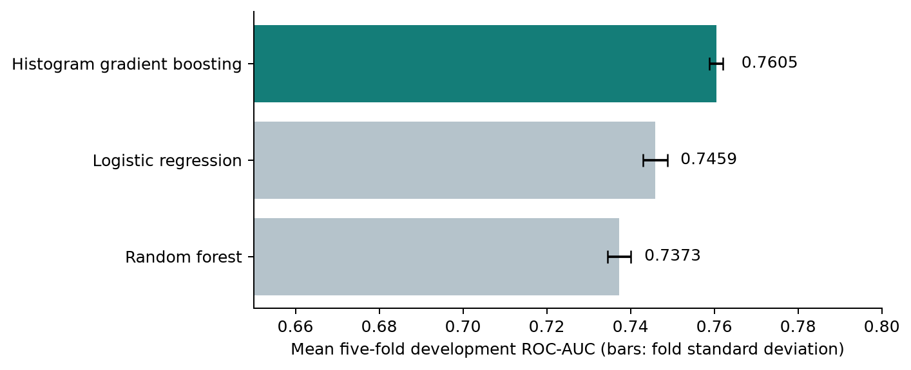
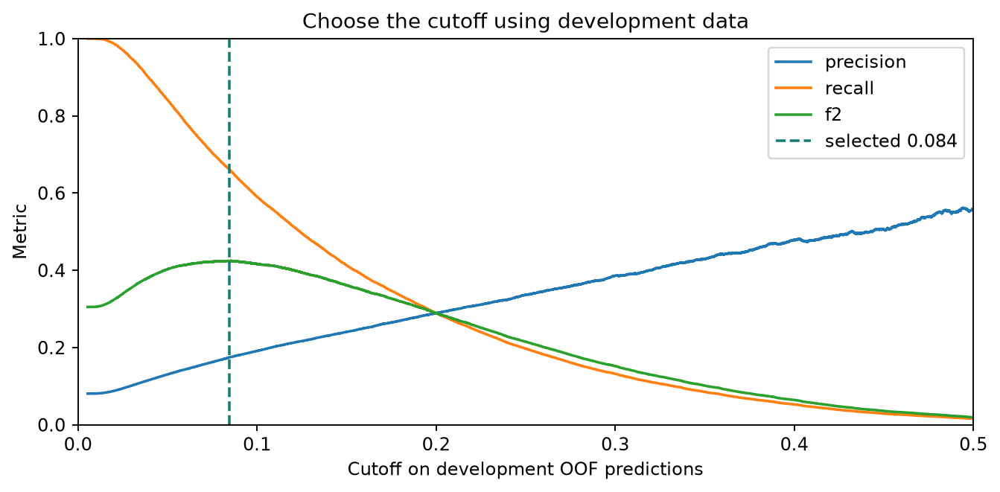
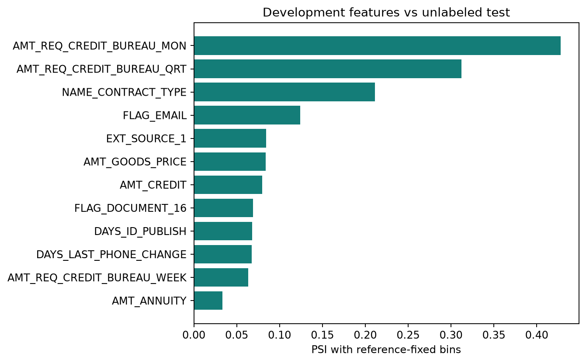

# Home Credit Default Risk

A credit-risk study using **307,511 labeled applications**, with application-table baselines and matched historical-feature experiments. It compares ranking, probability quality, operating-point tradeoffs and runtime, and examines calibration and train/test distribution drift.

## TL;DR

- **Current best (November 5):** with application, bureau, installment-payment and previous-application features, histogram gradient boosting (HGB) and LightGBM both reach **0.7801 mean fold ROC-AUC** (0.780062 vs 0.780078). The application-only score under the same protocol is 0.7623. The two algorithms are tied on ranking, and LightGBM fits in about a quarter of HGB's time.
- **What helped:** each credit-history family improved AUC in all five folds. For HGB, bureau added **+0.0058**, installments **+0.0083**, and previous applications **+0.0038**. A bundle of external-score summaries and application ratios showed **no gain** (−0.0002; its interval includes zero).
- **Operating point:** when flagging the riskiest 5% of applicants, HGB precision rises from **33.3% to 35.9%** and recall from **20.6% to 22.3%** relative to application-only.
- **October 4 baseline:** application-only HGB reached **0.7605 mean CV AUC** and **0.7654 random-holdout AUC**, ahead of logistic regression and random forest. A development-selected cutoff of **0.0844** raises holdout recall from 1.85% to 67.19% while precision falls from 63.45% to 17.69%.
- **Evaluation boundary:** the November results come from cross-validation on previously inspected development data. The original holdout was not scored, and independent final evaluation is still open.

[November 5 report](reports/2026-11-05_04_extended-history/2026-11-05_02_report.md) · [October 15 history follow-up](reports/2026-10-15_01_history-development/2026-10-15_02_report.md) · [October 4 technical report](reports/2026-10-04_03_home-credit/2026-10-04_02_report.md) · [PDF](reports/2026-10-04_03_home-credit/2026-10-04_03_results.pdf) · [Browser report](reports/2026-10-04_03_home-credit/2026-10-04_01_index.html) · [Experiment ledger](EXPERIMENTS.md) · [Report archive](REPORTS.md)

## Contents

1. [Results: credit-history stages, models, cutoffs, calibration, and drift](#results)
2. [Data and validation](#data-and-validation)
3. [Reproduce the experiment](#reproduce)
4. [Repository structure](#repository-structure)
5. [Limitations and next experiments](#limitations-and-next-experiments)
6. [References](#references)

The report follows the question → experiment → evidence → decision format. The [experiment ledger](EXPERIMENTS.md) separates measured outcomes from untested ideas.

## Results

### Credit-history stages (November 5)

Each stage adds one feature family to the previous one. All variants use the same 246,008 development applications and five folds. Every model uses a learning rate of 0.05 and up to 1,000 rounds, and stops early on an inner split of its own training fold. No fold reached the 1,000-round ceiling.

| Stage | Features | HGB mean fold AUC | LightGBM mean fold AUC | HGB OOF AP | Change vs previous stage (HGB, folds improved) |
| --- | ---: | ---: | ---: | ---: | --- |
| Application only | 123 | 0.7623 | 0.7631 | 0.2455 | — |
| + Bureau | 137 | 0.7681 | 0.7683 | 0.2543 | +0.0058 (5/5) |
| + Installment payments | 153 | 0.7765 | 0.7767 | 0.2648 | +0.0083 (5/5) |
| + External-score / ratio bundle | 162 | 0.7763 | 0.7762 | 0.2647 | −0.0002 (2/5) |
| + Previous applications | 178 | **0.7801** | **0.7801** | **0.2703** | +0.0038 (5/5) |

Paired bootstrap of pooled OOF predictions (1,000 replicates, stratified by fold and label):

| Comparison | ΔAUC | 95% interval | ΔAP | 95% interval |
| --- | ---: | --- | ---: | --- |
| HGB: + previous applications | +0.0038 | [+0.0030, +0.0046] | +0.0056 | [+0.0037, +0.0073] |
| LightGBM: + previous applications | +0.0039 | [+0.0031, +0.0047] | +0.0049 | [+0.0032, +0.0066] |
| HGB: + external-score / ratio bundle | −0.0002 | [−0.0010, +0.0006] | −0.0001 | [−0.0018, +0.0015] |
| LightGBM vs HGB, all features | −0.00001 | [−0.0006, +0.0006] | −0.0005 | [−0.0017, +0.0007] |

These intervals hold the fitted scores fixed. They don't include refitting variance, model selection, overlapping training folds, or population shift, so they are not generalization confidence intervals. The October 15 predictions get the same audit in a [separate report](reports/2026-11-05_03_original-history-audit/2026-11-05_02_report.md), where bureau plus installments gives ΔAUC +0.0129 [+0.0115, +0.0142].

The November runs changed the learning rate, round budget, stopping rule and refitting together. So the gain over October 15 (0.7734 → 0.7765 for the same features) can't be attributed to any single one of those changes. The full per-stage tables, top-k precision/recall and run times are in the [November 5 report](reports/2026-11-05_04_extended-history/2026-11-05_02_report.md).

### Model comparison (October 4, application table only)

All candidates use the same features and five stratified development folds. The winner is selected by mean fold ROC-AUC.

| Model | Mean CV ROC-AUC | Fold standard deviation | Holdout ROC-AUC |
| --- | ---: | ---: | ---: |
| Histogram gradient boosting | **0.7605** | 0.0016 | **0.7654** |
| Logistic regression | 0.7459 | 0.0029 | Not evaluated |
| Random forest | 0.7373 | 0.0027 | Not evaluated |



The configured gradient boosting model improves mean development AUC by **0.0145** over logistic regression. Only the winner is scored on the holdout. No Kaggle leaderboard score is available; cross-validation, holdout, and competition scores must remain separate.

### Cutoff experiment

The positive class (`TARGET = 1`) denotes repayment difficulty. The default cutoff misses most positive cases. The extension maximizes **F2 on development out-of-fold predictions**, giving recall more weight than precision.

| Rule on reused holdout | Cutoff | Precision | Recall | F2 | True positives | False positives |
| --- | ---: | ---: | ---: | ---: | ---: | ---: |
| Fixed cutoff | 0.5000 | 63.45% | 1.85% | 0.0230 | 92 | 53 |
| Development-selected F2 | **0.0844** | **17.69%** | **67.19%** | **0.4309** | **3,336** | **15,517** |

The selected rule flags **30.65%** of applications. It catches more repayment-difficulty cases at the cost of many more false positives. Changing the cutoff does not improve AUC or probability calibration.



**Evaluation boundary:** the holdout contains 61,503 rows, including 4,965 positive cases. It was inspected in the initial benchmark and reused for follow-up diagnostics. The cutoff search uses development labels only, but the follow-up holdout results are not fresh final validation.

### Calibration and drift

- Reused-holdout Brier score: **0.06733**; log loss: **0.24398**. Calibration is checked by score decile; no recalibration model was fitted.
- Same-model score PSI: **0.00384**. Both the holdout and unlabeled test table are scored by the same development-fitted model.
- Some raw feature distributions shift substantially despite the small score PSI. Distribution similarity does not establish calibration or predictive performance.



## Data and validation

Data comes from [Kaggle Home Credit Default Risk](https://www.kaggle.com/competitions/home-credit-default-risk/data). The published October 4 study uses `application_train.csv` and `application_test.csv`. The history experiments below add `bureau.csv`, `installments_payments.csv` and `previous_application.csv` as separate stages; they do not change the published benchmark. The competition test table has **48,744 unlabeled rows**, so local test predictions cannot provide AUC.

1. Validate binary labels and unique applicant IDs. Remove the ID and target from predictors.
2. Replace the employment sentinel `365243` with missing values. Add credit/income, annuity/income, and credit/annuity ratios.
3. Make a stratified 80/20 split with seed 42: **246,008 development rows** and **61,503 holdout rows**.
4. Fit preprocessing within each training fold: median imputation, scaling, categorical imputation, and one-hot encoding with rare-category grouping.
5. Compare candidates on five shared development folds. Save out-of-fold probabilities, where each row is scored by a model that did not fit it.
6. Select the model and F2 cutoff using development predictions. Evaluate the selected configuration on the holdout and retain the original 0.5 comparison.
7. Refit the selected configuration on all labeled rows and export unlabeled test probabilities locally.

The same development folds select both the model and cutoff, so optimized development results may be optimistic. The split is random; it does not establish temporal or customer-group generalization.

## Reproduce

Run from the project root with Python 3.13 (the version used for the saved experiment).

```bash
python3 -m venv .venv
source .venv/bin/activate
python -m pip install -r requirements.txt -r requirements-reporting.txt
```

Download the competition files using your own Kaggle account and accepted competition rules. Place the train/test CSVs in `data/raw/`. Raw data, archives, predictions, and fitted models are excluded from Git.

```bash
# Full real-data benchmark and diagnostics
python -m src.train --monitoring --shap --test data/raw/application_test.csv

# Generate Markdown, HTML, PDF, figures, and compact result tables
python clean_report.py

# Run verification
python -m unittest discover -s tests -v

# Synthetic software check; scores are not Home Credit results
python -m src.train --demo --monitoring --shap
```

Training creates a new dated, numbered run folder. Reporting reads the latest completed real-data run without retraining. Use `python clean_report.py --source outputs/<run-folder>` to regenerate a particular run. Readers of the published repository can inspect the tracked report and compact tables without downloading the dataset.

LightGBM is an optional candidate (`--lightgbm`), **not evaluated in the published October 4 experiment**. It is tested separately in the staged comparison below. On macOS it needs an available OpenMP runtime. Other dependency versions are bounded in the requirements files, not frozen to a lockfile, so exact numerical reproduction across environments is not guaranteed.

### Opt-in bureau history comparison

The application-only `src.train` command is unchanged. To test whether credit history adds information, run a separate, bounded ablation with the same histogram boosting configuration and the same application rows/folds for both variants:

```bash
python -m src.compare_bureau \
  --bureau data/archive/2026-10-04_00_home-credit-default-risk.zip \
  --max-development-rows 30000 --folds 5 --threads 2
```

Use your local dataset archive's filename, or pass `--bureau data/raw/bureau.csv`. The command reads only `bureau.csv` from a ZIP without extracting it or downloading data. Defaults cap the comparison at 30,000 development applications, five folds, 150 boosting iterations, and two native threads. There is no tuning search. `--max-development-rows 0` explicitly uses all development rows; `--max-iter` can reduce the iteration cap for a quick check.

The runner recreates the original seed-42 80/20 split and development folds **before** subsampling within label/fold strata. The original 20% holdout is excluded and is never scored. Each variant learns its preprocessing inside its training fold. The row cap changes training size and can change early stopping, so compare the two variants within this run, not against the full-data October 4 score.

`src/bureau.py` uses a fixed whitelist of 14 aggregate features: record/active counts, active fraction, known credit/debt/overdue sums and coverage counts, a debt-to-credit ratio, and credit/update recency. Records require finite credit and update dates at or before application day 0. Supplied actual closure dates after day 0 or invalid nonmissing actual closure dates also exclude a record. Unknown credit/update dates are excluded. Scheduled future maturity dates are not used. These checks screen the supplied snapshots; they cannot reconstruct earlier balances or independently establish source availability.

History is aggregated to one row per applicant before a cardinality-checked left join. Application IDs, row order, index, and labels are preserved. No eligible history gives zero count features and missing balances/ratios; an unknown balance is not silently zero. Finite negative debt is retained as a signed net balance. Negative credit/overdue amounts and nonfinite amounts are masked. Ratios use only loans with known debt and positive credit, with a coverage count; zero denominators remain missing. No target encoding or global learned bureau statistics are used.

Each dated `outputs/*_bureau-comparison/` folder contains a Markdown report, per-fold and pooled OOF AUC/AP/Brier/log-loss metrics, paired fold deltas, applicant/fold assignments, OOF predictions, feature schema, exclusion audit, input/code hashes, dependency versions, and run arguments. Existing output directories cannot be overwritten. Row-level predictions stay Git-ignored. This is development evidence; model/cutoff selection, fresh final validation, profitability, and operational lending decisions are outside this comparison.

### Full-development history and LightGBM comparisons

The follow-up compares three feature sets (application-only, application + bureau, and application + bureau + installments) for histogram boosting and optional LightGBM. Every variant uses the same development applicants and folds; the original holdout stays excluded. First run the bureau ablation with `--max-development-rows 0` to use all 246,008 development rows. Then run:

```bash
python -m src.compare_history \
  --archive data/archive/2026-10-04_00_home-credit-default-risk.zip \
  --reuse-bureau-run outputs/2026-10-14_03_bureau-full-development \
  --max-development-rows 0 --folds 5 --threads 2 --include-lightgbm
```

Use your own completed bureau folder, or omit `--reuse-bureau-run` to fit every variant. Reuse verifies input hashes, feature/training code, model configuration, exact IDs/labels/folds and saved OOF metrics. Defaults still cap the sample at 30,000 unless `0` is explicit. HGB retains its original configuration and internal early stopping. The fixed LightGBM preset uses 200 trees, learning rate 0.05, 15 leaves, L2 regularization 1, seed 42, deterministic column-wise training and two threads. This compares configured models, not each family's best achievable performance. There is no tuning search or outer-fold early stopping.

`src/installments.py` streams approved columns in 250,000-row chunks for development IDs only. Both due and observed payment dates must be finite and at or before application day 0. Future/unknown payment rows cannot influence amounts, schedule versions or ambiguity decisions. This is observed past-payment history, not a census of all unpaid obligations; prepaid installments with future scheduled due dates are conservatively excluded.

Payment tranches aggregate to one obligation per applicant/previous-loan/installment number, then one applicant row. Conflicting versions/due amounts/dates and exact duplicate-event groups are excluded because no transaction ID resolves them. Scheduled amounts count once, payments sum, and shortfall requires all contributing amounts to be known. Missing, negative or nonfinite amounts cannot manufacture shortfalls. Zero-denominator ratios stay missing, overpayments have zero shortfall, and absent histories have zero count features and missing amounts. Delay describes payment-tranche timing, not exact loan cure time. Snapshot provenance still needs independent review.

Reports save ROC-AUC, AP, Brier/log loss, fit times, pooled/per-fold precision and recall at top 5%, 10%, 20% and score 0.5, with TP/FP/FN. Rank ties use applicant ID without label-based cutoff tuning. Paired deltas distinguish feature additions within an algorithm from algorithms on the same features. Negative results are retained. Exact folds, predictions, input/code/version manifests, feature schemas and exclusion audits stay alongside the report. No holdout scoring, final refit or submission occurs.

Each completed fold writes an atomic numeric checkpoint. After interruption, repeat the identical command with the same `--output` directory and `--resume`. Resume verifies code, inputs, versions, model settings, assignments and completed-fold metrics; changed inputs or settings are rejected. A completed run resumes without duplicate fits.

On the tested Mac, LightGBM was installed but could not locate OpenMP. The compatible runtime already bundled with scikit-learn worked with this **process-local** command prefix:

```bash
DYLD_FALLBACK_LIBRARY_PATH="$(python -c 'from pathlib import Path; from importlib.util import find_spec; print(Path(find_spec("sklearn").origin).parent / ".dylibs")')" \
  python -m src.compare_history --archive data/archive/2026-10-04_00_home-credit-default-risk.zip \
  --max-development-rows 0 --threads 2 --include-lightgbm
```

Use that fallback only when a trusted compatible runtime exists there. It changes no system setting, and the manifest records the path. Otherwise install the optional dependency/runtime normally in your environment, or omit `--include-lightgbm`. [NoxMoon's reference](https://github.com/NoxMoon/home-credit-default-risk) motivated repayment-delay/shortfall ideas; this independent implementation does not reproduce its leaderboard score.

### Larger budgets, two new feature stages, and paired bootstrap intervals

The October 15 models used ceilings of 150 HGB iterations and 200 LightGBM trees. Reaching a ceiling alone does not establish that additional trees improve validation performance. `src.compare_history` accepts larger budgets to test this with early stopping inside each training fold:

```
python -m src.compare_history \
  --archive data/archive/2026-10-04_00_home-credit-default-risk.zip \
  --max-development-rows 0 --folds 5 --threads 2 --include-lightgbm \
  --stages application_only application_bureau application_bureau_installments \
           application_bureau_installments_ext application_bureau_installments_ext_previous \
  --learning-rate 0.05 --patience 30 --max-iter 1000 --lgbm-estimators 1000
```

- **Early stopping:** With `--patience`, both algorithms use the same seeded, stratified 10% inner stopping split. During stopping, preprocessing fits only the other 90%. The best observed inner log-loss iteration is selected (excluding HGB's patience tail), then a fresh preprocessor and fixed-length model fit the full outer training fold. Outer validation is excluded throughout. This mode requires scikit-learn ≥1.7 for [explicit HGB validation inputs](https://scikit-learn.org/stable/whats_new/v1.7.html). Without `--patience`, the legacy fits are retained. Changed stopping or learning-rate settings reject the original bureau-run cache.
- **`ext` stage:** `src/application.py` adds row-local application features: the mean, min, max, std and product of the external scores, how many of them are known, employed/age days, goods/credit, and income per family member. They are kept out of `src/train.py`, so the published benchmark and its code hash are unchanged.
- **`previous` stage:** `src/previous.py` aggregates `previous_application.csv`: status counts, refusal fraction, refusals and applications in the last 365 days, time since the last decision, approval and refusal, approved credit and annuity sums, the credit/requested ratio and the mean term. Records need a finite decision day ≤ 0. Scheduled due and termination dates, and their 365243 sentinels, are not used.
- **`--bootstrap N`:** Optional paired applicant resampling within each label saves conditional percentile intervals for pooled OOF ΔAUC and ΔAP. These condition on fixed scores and prevalence; they omit refitting variance, overlapping-fold dependence, model selection and population shift. They are not generalization confidence intervals or significance tests. Negative comparisons remain in the output.
- **Iteration diagnostics:** Per-fold metrics distinguish search rounds, selected length and actual refit iterations. Comparison tables include mean search/refit iterations and the number of folds reaching their search budget. Training times include both inner selection and full-fold refitting.

These are development-fold experiments. As before, the original holdout is excluded.

### Audit saved predictions without retraining

```bash
python -m src.audit_oof \
  --source outputs/2026-11-05_02_inner-history \
  --output reports/2026-11-05_04_oof-audit --repetitions 1000
```

This separate audit checks source prediction/cohort hashes, exact assignments, complete variant/fold coverage, and recomputed per-fold and pooled metrics before analysis. It resamples the same applicants for both models within each **fold and label**, retaining each stratum's size. A fixed seed and canonical applicant order make results reproducible after CSV reordering. Defaults compare application-only HGB with HGB plus bureau/installments; select other saved variants with `--baseline` and `--candidate`.

Aggregate-only outputs include paired AUC/AP percentile intervals, fixed equal-width calibration bins pooled and by fold (including empty bins), Brier/log loss, source/code hashes and package versions. Existing output folders are rejected. The audit reads no holdout/test data and fits no calibrator or cutoff. Its conditional intervals have the same limitations described above; artifact consistency does not independently prove how the original models were trained.

The [completed audit of the October 15 predictions](reports/2026-11-05_03_original-history-audit/2026-11-05_02_report.md) is available without raw data. To reproduce the November experiment's numerical environment, install `requirements-experiment.txt` in a fresh Python 3.13 environment; the manifest also records the process-local native runtime path. Unit tests use synthetic fixtures and run in the included software-check workflow without competition data.

## From scores to decisions

These three commands move the project from a validated model to a lending workflow: one independent score, a decision rule tied to loan economics, and a reason for each high-risk score. None of them change any earlier result.

### 1. One frozen, independent score

```bash
python -m src.submit --archive data/archive/2026-10-04_00_home-credit-default-risk.zip
```

`src/submit.py` freezes the full-feature stage (application + bureau + installments + extended + previous applications) with the November 5 protocol: LightGBM, learning rate 0.05, up to 1,000 rounds, patience 30 on an inner 10% split. It fits on all 307,511 labeled rows and scores the 48,744 competition-test applicants. Each history aggregate uses only that applicant's own records, so building train and test features together shares no statistics between them. The run saves `submission.csv`, the fitted model, a configuration hash, input/code hashes and the history audits. It does **not** upload anything. Submit the file once with the Kaggle command printed in its report, then record the leaderboard AUC. Submitting repeatedly and keeping the best score would turn the leaderboard into another tuning set.

### 2. Expected loss and a cost-based cutoff

```bash
python -m src.decision --source outputs/<history-comparison run> --margin 0.10 --lgd 0.45
```

`src/decision.py` turns saved out-of-fold probabilities into approve/decline decisions and money. Every approved loan has exposure EAD = `AMT_CREDIT`. A repaid loan earns `margin × EAD`, and a loan with repayment difficulty loses `LGD × EAD`. Approving applicant *i* has positive expected value when

```text
(1 − PD) × margin − PD × LGD > 0   ⇔   PD < margin / (margin + LGD)
```

So the cost-based cutoff needs no labels, and EAD cancels out. Every assumption is set in one place, the `Economics` object in `src/decision.py`. It has four settings, each with a command-line flag: `--margin`, `--lgd`, `--loss-share` (the share of payment difficulties that end in a loss) and `--ead-share` (the share of the loan still owed at default). With partial losses the cutoff becomes `margin / (loss_share × (margin + LGD × ead_share))`. Each run writes `assumptions.csv` and an Assumptions section in the report. These list every economic and modelling assumption, where its value comes from, and which way it biases the result. The defaults treat every payment difficulty as a full loss on the whole credit amount, which overstates losses. The report compares approving everyone, PD < 0.5, the F2 cutoff, rejecting the riskiest 5/10/20%, the cost-based cutoff, and the best cutoff found with hindsight (an upper bound, not a policy). It saves realized and model-expected profit, a profit curve, a margin × LGD sensitivity grid, and predicted vs. realized loss by score decile. Margin and LGD are assumptions: the default LGD of 45% is the Basel foundation-IRB value for senior unsecured exposures, and Home Credit's real pricing and recoveries are not in the data. TARGET flags payment difficulty, not a written-off loss.

### 3. Reason codes for each applicant

`src.submit` saves the top three risk-raising inputs for every scored applicant by default (`--reasons 3`). Pass `--reason-cutoff 0.18` to keep only applicants above a decline cutoff. `src/reasons.py` uses LightGBM's exact tree contributions (TreeSHAP). The applicant's log-odds score splits into a baseline plus one contribution per input column, and one-hot indicators are summed back to their original column. Each run checks that the contributions add up to the model's score. Every reason row gives the feature, its family (bureau, installments, previous applications, external scores, application), the applicant's own value and its contribution in log-odds. `reason_summary.csv` counts how often each input is the main reason. These explain the model's score; they don't show what caused a default.

## Repository structure

```text
src/                 Training, monitoring, history features (bureau, installments, previous
                     applications, extended application), staged comparisons, frozen
                     submission, decision/expected-loss layer, reason codes, artifact naming
tests/               Preprocessing, monitoring, history-feature boundaries, early stopping,
                     bootstrap, matched-fold, submission, decision and reason-code checks
reports/             Dated reports, figures, compact tables, source manifests
outputs/             Local-only full predictions and fitted models
data/raw/            Local-only competition CSV inputs
data/archive/        Local-only downloaded archive
clean_report.py      Report generation from saved artifacts
EXPERIMENTS.md       Hypotheses, evidence, decisions, and untested ideas
REPORTS.md           Current report and archive index
```

Within each run, files use `YYYY-MM-DD_NN_description.ext`. `NN` is a reading-order number; the directory has its own per-date run number. Optional artifacts may leave gaps. [The report start page](reports/2026-10-04_03_home-credit/2026-10-04_00_start-here.md) describes the saved files.

## Limitations and next experiments

This is a reproducible application-table baseline plus matched development experiments with three credit-history tables. It does not demonstrate production readiness, lending profitability, fairness, or a winning competition solution.

Next steps, in order:

1. Run `src.submit` and submit the frozen pipeline once to Kaggle, for an independent score. The code is in place; the score is not yet recorded.
2. Run `src.decision` on the November 5 predictions and publish the policy comparison.
3. Test the remaining history tables: `bureau_balance`, `POS_CASH_balance` and `credit_card_balance`.
4. Test previous-application history without the external-score / ratio bundle, which showed no gain.
5. Audit fairness: error and approval rates by gender and age band, and checks for proxy features.

- The holdout has been reused. Future model development needs independent final evaluation data.
- External-score provenance and predictor availability at application time require further review.
- SHAP uses 100 development rows; permutation importance uses 500 development rows in sample. Neither is causal, and correlated predictors affect interpretation.
- PSI flags use simulated feature-wise null estimates without multiple-testing correction. There are no test labels to check test calibration or AUC.
- The published October 4 benchmark has no historical features. The dated development experiments include bureau, installments, an application-feature bundle and previous applications. Other historical tables, broad hyperparameter searches and fitted recalibration remain untested.

Assess paired changes and operating-point precision/recall before retaining added complexity, then seek independent final evaluation. [The first-place solution](https://www.kaggle.com/competitions/home-credit-default-risk/writeups/home-aloan-1st-place-solution) motivates historical features; it does not establish a transferable gain for this implementation.

## References

- [William Koehrsen: Start Here - A Gentle Introduction](https://www.kaggle.com/code/willkoehrsen/start-here-a-gentle-introduction): exploratory analysis, anomalies, and baseline comparisons.


Saved results from October 4 through November 5, 2026 are dated in the experiment ledger. External sources are methodological references; their reported performance is not a controlled comparison with this project.
