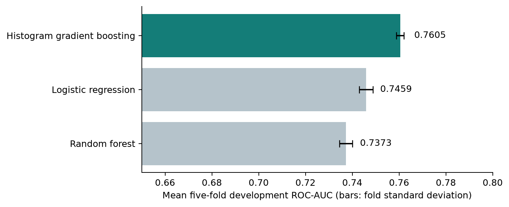
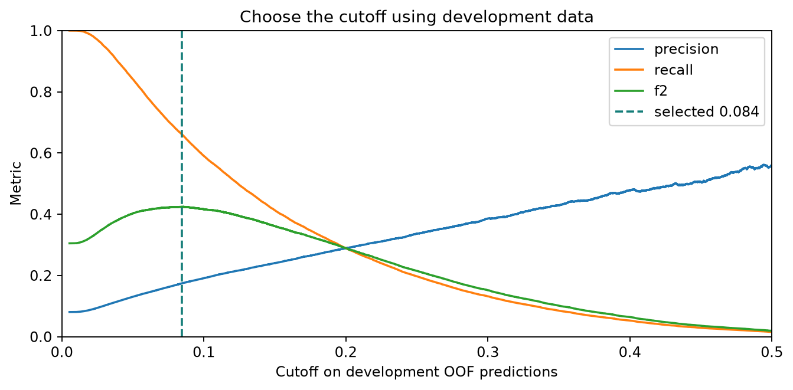
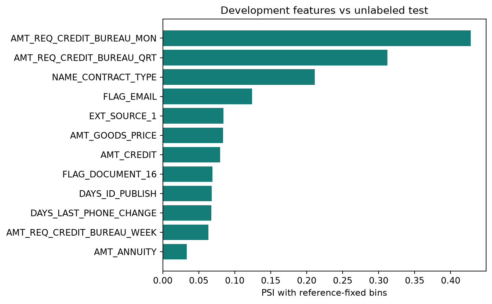

# Home Credit Default Risk

An application-table credit-risk study using **307,511 labeled applications**. The project compares three classifiers, selects a decision cutoff from development predictions, and examines calibration and train/test distribution drift.

## TL;DR

- **Model ranking:** histogram gradient boosting reached **0.7605 mean cross-validation ROC-AUC** and **0.7654 random-holdout ROC-AUC**, ahead of the configured logistic regression and random forest baselines.
- **Cutoff tradeoff:** selecting **0.0844** from development predictions raises reused-holdout recall from **1.85% to 67.19%**, while precision falls from **63.45% to 17.69%**. This is an error tradeoff; lending profit has not been measured.
- **Monitoring:** score PSI is **0.00384**, yet some input distributions shift substantially. A stable score distribution does not establish stable calibration or predictive performance.
- **Full-development follow-up:** `hgb_application_bureau_installments` reached **0.7734 mean fold AUC** and **0.2605 OOF AP** on matched development folds. This uses previously inspected development data; the original holdout was not scored. See [the experiment ledger](EXPERIMENTS.md#full-development-staged-follow-up) for all variants and precision/recall tradeoffs.

[History follow-up](reports/2026-10-15_01_history-development/2026-10-15_02_report.md) · [Technical report](reports/2026-10-04_03_home-credit/2026-10-04_02_report.md) · [PDF](reports/2026-10-04_03_home-credit/2026-10-04_03_results.pdf) · [Browser report](reports/2026-10-04_03_home-credit/2026-10-04_01_index.html) · [Experiment ledger](EXPERIMENTS.md) · [Report archive](REPORTS.md)

## Contents

1. [Results: models, cutoffs, calibration, and drift](#results)
2. [Data and validation](#data-and-validation)
3. [Reproduce the experiment](#reproduce)
4. [Repository structure](#repository-structure)
5. [Limitations and next experiments](#limitations-and-next-experiments)
6. [References](#references)

The report follows the question → experiment → evidence → decision format. The [experiment ledger](EXPERIMENTS.md) separates measured outcomes from untested ideas.

## Results

### Model comparison

All candidates use the same features and five stratified development folds. The winner is selected by mean fold ROC-AUC.

| Model | Mean CV ROC-AUC | Fold standard deviation | Holdout ROC-AUC |
| --- | ---: | ---: | ---: |
| Histogram gradient boosting | **0.7605** | 0.0016 | **0.7654** |
| Logistic regression | 0.7459 | 0.0029 | Not evaluated |
| Random forest | 0.7373 | 0.0027 | Not evaluated |



The configured gradient boosting model improves mean development AUC by **0.0145** over logistic regression. Only the winner is scored on the holdout. No Kaggle leaderboard score is available; cross-validation, holdout, and competition scores must remain separate.

### Cutoff experiment

The positive class (`TARGET = 1`) denotes repayment difficulty. The default cutoff misses most positive cases. The extension maximizes **F2 on development out-of-fold predictions**, giving recall more weight than precision.

| Rule on reused holdout | Cutoff | Precision | Recall | F2 | True positives | False positives |
| --- | ---: | ---: | ---: | ---: | ---: | ---: |
| Fixed cutoff | 0.5000 | 63.45% | 1.85% | 0.0230 | 92 | 53 |
| Development-selected F2 | **0.0844** | **17.69%** | **67.19%** | **0.4309** | **3,336** | **15,517** |

The selected rule flags **30.65%** of applications. It catches more repayment-difficulty cases at the cost of many more false positives. Changing the cutoff does not improve AUC or probability calibration.



**Evaluation boundary:** the holdout contains 61,503 rows, including 4,965 positive cases. It was inspected in the initial benchmark and reused for follow-up diagnostics. The cutoff search uses development labels only, but the follow-up holdout results are not fresh final validation.

### Calibration and drift

- Reused-holdout Brier score: **0.06733**; log loss: **0.24398**. Calibration is checked by score decile; no recalibration model was fitted.
- Same-model score PSI: **0.00384**. Both the holdout and unlabeled test table are scored by the same development-fitted model.
- Some raw feature distributions shift substantially despite the small score PSI. Distribution similarity does not establish calibration or predictive performance.



## Data and validation

Data comes from [Kaggle Home Credit Default Risk](https://www.kaggle.com/competitions/home-credit-default-risk/data). The published October 4 study uses `application_train.csv` and `application_test.csv`. The opt-in bureau experiment below adds one historical feature family separately; it does not change the published benchmark. The competition test table has **48,744 unlabeled rows**, so local test predictions cannot provide AUC.

1. Validate binary labels and unique applicant IDs. Remove the ID and target from predictors.
2. Replace the employment sentinel `365243` with missing values. Add credit/income, annuity/income, and credit/annuity ratios.
3. Make a stratified 80/20 split with seed 42: **246,008 development rows** and **61,503 holdout rows**.
4. Fit preprocessing within each training fold: median imputation, scaling, categorical imputation, and one-hot encoding with rare-category grouping.
5. Compare candidates on five shared development folds. Save out-of-fold probabilities, where each row is scored by a model that did not fit it.
6. Select the model and F2 cutoff using development predictions. Evaluate the selected configuration on the holdout and retain the original 0.5 comparison.
7. Refit the selected configuration on all labeled rows and export unlabeled test probabilities locally.

The same development folds select both the model and cutoff, so optimized development results may be optimistic. The split is random; it does not establish temporal or customer-group generalization.

## Reproduce

Run from the project root with Python 3.13 (the version used for the saved experiment).

```bash
python3 -m venv .venv
source .venv/bin/activate
python -m pip install -r requirements.txt -r requirements-reporting.txt
```

Download the competition files using your own Kaggle account and accepted competition rules. Place the train/test CSVs in `data/raw/`. Raw data, archives, predictions, and fitted models are excluded from Git.

```bash
# Full real-data benchmark and diagnostics
python -m src.train --monitoring --shap --test data/raw/application_test.csv

# Generate Markdown, HTML, PDF, figures, and compact result tables
python clean_report.py

# Run verification
python -m unittest discover -s tests -v

# Synthetic software check; scores are not Home Credit results
python -m src.train --demo --monitoring --shap
```

Training creates a new dated, numbered run folder. Reporting reads the latest completed real-data run without retraining. Use `python clean_report.py --source outputs/<run-folder>` to regenerate a particular run. Readers of the published repository can inspect the tracked report and compact tables without downloading the dataset.

LightGBM is an optional candidate (`--lightgbm`), **not evaluated in the published October 4 experiment**. It is tested separately in the staged comparison below. On macOS it needs an available OpenMP runtime. Other dependency versions are bounded in the requirements files, not frozen to a lockfile, so exact numerical reproduction across environments is not guaranteed.

### Opt-in bureau history comparison

The application-only `src.train` command is unchanged. To test whether credit history adds information, run a separate, bounded ablation with the same histogram boosting configuration and the same application rows/folds for both variants:

```bash
python -m src.compare_bureau \
  --bureau data/archive/2026-10-04_00_home-credit-default-risk.zip \
  --max-development-rows 30000 --folds 5 --threads 2
```

Use your local dataset archive's filename, or pass `--bureau data/raw/bureau.csv`. The command reads only `bureau.csv` from a ZIP without extracting it or downloading data. Defaults cap the comparison at 30,000 development applications, five folds, 150 boosting iterations, and two native threads. There is no tuning search. `--max-development-rows 0` explicitly uses all development rows; `--max-iter` can reduce the iteration cap for a quick check.

The runner recreates the original seed-42 80/20 split and development folds **before** subsampling within label/fold strata. The original 20% holdout is excluded and is never scored. Each variant learns its preprocessing inside its training fold. The row cap changes training size and can change early stopping, so compare the two variants within this run, not against the full-data October 4 score.

`src/bureau.py` uses a fixed whitelist of 14 aggregate features: record/active counts, active fraction, known credit/debt/overdue sums and coverage counts, a debt-to-credit ratio, and credit/update recency. Records require finite credit and update dates at or before application day 0. Supplied actual closure dates after day 0 or invalid nonmissing actual closure dates also exclude a record. Unknown credit/update dates are excluded. Scheduled future maturity dates are not used. These checks screen the supplied snapshots; they cannot reconstruct earlier balances or independently establish source availability.

History is aggregated to one row per applicant before a cardinality-checked left join. Application IDs, row order, index, and labels are preserved. No eligible history gives zero count features and missing balances/ratios; an unknown balance is not silently zero. Finite negative debt is retained as a signed net balance. Negative credit/overdue amounts and nonfinite amounts are masked. Ratios use only loans with known debt and positive credit, with a coverage count; zero denominators remain missing. No target encoding or global learned bureau statistics are used.

Each dated `outputs/*_bureau-comparison/` folder contains a Markdown report, per-fold and pooled OOF AUC/AP/Brier/log-loss metrics, paired fold deltas, applicant/fold assignments, OOF predictions, feature schema, exclusion audit, input/code hashes, dependency versions, and run arguments. Existing output directories cannot be overwritten. Row-level predictions stay Git-ignored. This is development evidence; model/cutoff selection, fresh final validation, profitability, and operational lending decisions are outside this comparison.

### Full-development history and LightGBM comparisons

The follow-up compares three feature sets (application-only, application + bureau, and application + bureau + installments) for histogram boosting and optional LightGBM. Every variant uses the same development applicants and folds; the original holdout stays excluded. First run the bureau ablation with `--max-development-rows 0` to use all 246,008 development rows. Then run:

```bash
python -m src.compare_history \
  --archive data/archive/2026-10-04_00_home-credit-default-risk.zip \
  --reuse-bureau-run outputs/2026-10-14_03_bureau-full-development \
  --max-development-rows 0 --folds 5 --threads 2 --include-lightgbm
```

Use your own completed bureau folder, or omit `--reuse-bureau-run` to fit every variant. Reuse verifies input hashes, feature/training code, model configuration, exact IDs/labels/folds and saved OOF metrics. Defaults still cap the sample at 30,000 unless `0` is explicit. HGB retains its original configuration and internal early stopping. The fixed LightGBM preset uses 200 trees, learning rate 0.05, 15 leaves, L2 regularization 1, seed 42, deterministic column-wise training and two threads. This compares configured models, not each family's best achievable performance. There is no tuning search or outer-fold early stopping.

`src/installments.py` streams approved columns in 250,000-row chunks for development IDs only. Both due and observed payment dates must be finite and at or before application day 0. Future/unknown payment rows cannot influence amounts, schedule versions or ambiguity decisions. This is observed past-payment history, not a census of all unpaid obligations; prepaid installments with future scheduled due dates are conservatively excluded.

Payment tranches aggregate to one obligation per applicant/previous-loan/installment number, then one applicant row. Conflicting versions/due amounts/dates and exact duplicate-event groups are excluded because no transaction ID resolves them. Scheduled amounts count once, payments sum, and shortfall requires all contributing amounts to be known. Missing, negative or nonfinite amounts cannot manufacture shortfalls. Zero-denominator ratios stay missing, overpayments have zero shortfall, and absent histories have zero count features and missing amounts. Delay describes payment-tranche timing, not exact loan cure time. Snapshot provenance still needs independent review.

Reports save ROC-AUC, AP, Brier/log loss, fit times, pooled/per-fold precision and recall at top 5%, 10%, 20% and score 0.5, with TP/FP/FN. Rank ties use applicant ID without label-based cutoff tuning. Paired deltas distinguish feature additions within an algorithm from algorithms on the same features. Negative results are retained. Exact folds, predictions, input/code/version manifests, feature schemas and exclusion audits stay alongside the report. No holdout scoring, final refit or submission occurs.

Each completed fold writes an atomic numeric checkpoint. After interruption, repeat the identical command with the same `--output` directory and `--resume`. Resume verifies code, inputs, versions, model settings, assignments and completed-fold metrics; changed inputs or settings are rejected. A completed run resumes without duplicate fits.

On the tested Mac, LightGBM was installed but could not locate OpenMP. The compatible runtime already bundled with scikit-learn worked with this **process-local** command prefix:

```bash
DYLD_FALLBACK_LIBRARY_PATH="$(python -c 'from pathlib import Path; from importlib.util import find_spec; print(Path(find_spec("sklearn").origin).parent / ".dylibs")')" \
  python -m src.compare_history --archive data/archive/2026-10-04_00_home-credit-default-risk.zip \
  --max-development-rows 0 --threads 2 --include-lightgbm
```

Use that fallback only when a trusted compatible runtime exists there. It changes no system setting, and the manifest records the path. Otherwise install the optional dependency/runtime normally in your environment, or omit `--include-lightgbm`. [NoxMoon's reference](https://github.com/NoxMoon/home-credit-default-risk) motivated repayment-delay/shortfall ideas; this independent implementation does not reproduce its leaderboard score.

## Repository structure

```text
src/                 Training, monitoring, bureau ablation, data download, artifact naming
tests/               Preprocessing, monitoring, bureau boundary and matched-fold checks
reports/             Dated reports, figures, compact tables, source manifests
outputs/             Local-only full predictions and fitted models
data/raw/            Local-only competition CSV inputs
data/archive/        Local-only downloaded archive
clean_report.py      Report generation from saved artifacts
EXPERIMENTS.md       Hypotheses, evidence, decisions, and untested ideas
REPORTS.md           Current report and archive index
```

Within each run, files use `YYYY-MM-DD_NN_description.ext`. `NN` is a reading-order number; the directory has its own per-date run number. Optional artifacts may leave gaps. [The report start page](reports/2026-10-04_03_home-credit/2026-10-04_00_start-here.md) describes the saved files.

## Limitations and next experiments

This is a reproducible application-table baseline with diagnostic extensions. It does not demonstrate production readiness, lending profitability, fairness, or a winning competition solution.

- The holdout has been reused. Future model development needs independent final evaluation data.
- External-score provenance and predictor availability at application time require further review.
- SHAP uses 100 development rows; permutation importance uses 500 development rows in sample. Neither is causal, and correlated predictors affect interpretation.
- PSI flags use simulated feature-wise null estimates without multiple-testing correction. There are no test labels to check test calibration or AUC.
- The published October 4 benchmark has no historical features. Bureau/installment and LightGBM comparisons are separate development experiments; other historical families, hyperparameter search and fitted recalibration remain untested.

Assess paired changes and operating-point precision/recall before retaining added complexity, then seek independent final evaluation. [The first-place solution](https://www.kaggle.com/competitions/home-credit-default-risk/writeups/home-aloan-1st-place-solution) motivates historical features; it does not establish a transferable gain for this implementation.

## References

- [William Koehrsen: Start Here - A Gentle Introduction](https://www.kaggle.com/code/willkoehrsen/start-here-a-gentle-introduction): exploratory analysis, anomalies, and baseline comparisons.


Saved results are from October 4, 2026. External sources are methodological references; their reported performance is not a controlled comparison with this project.
